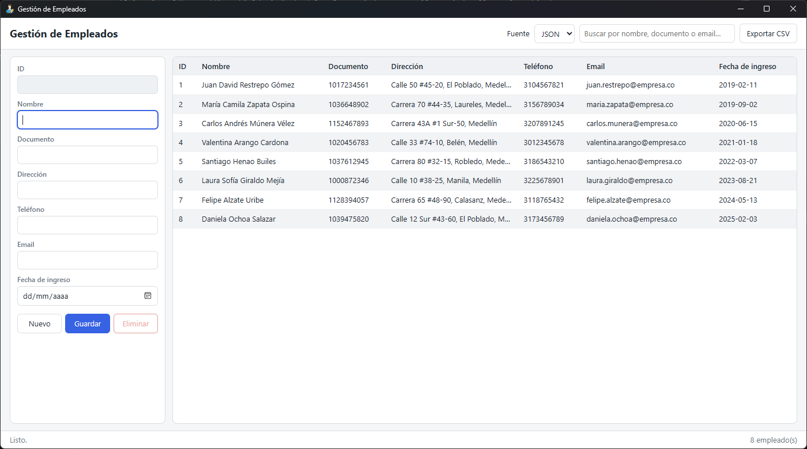
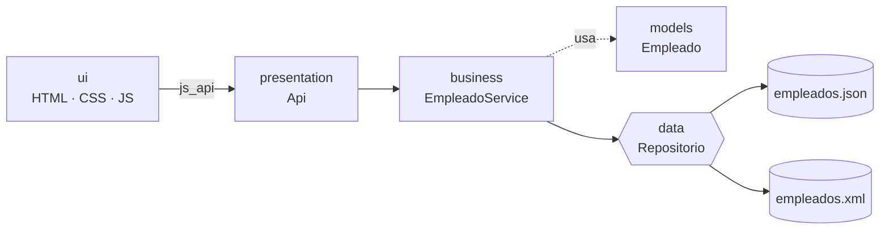
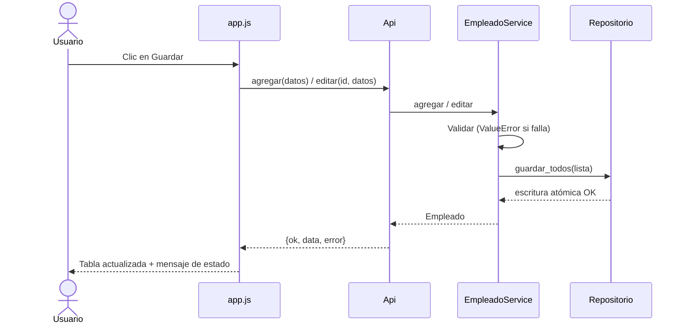
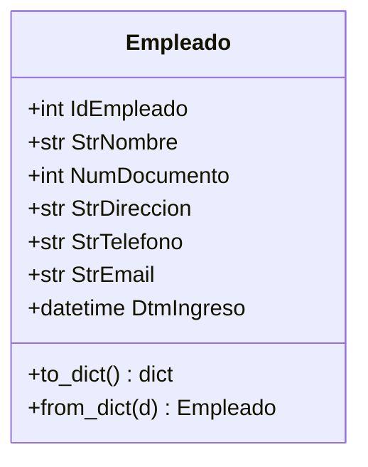

# Gestión de Empleados


App de escritorio CRUD (Python 3.10+ y pywebview). Los datos se guardan en JSON o XML. Solo usa la librería estándar para los datos.




## Funcionalidades
| | Función | Detalle |
|---|---|---|
| 📋 | Listar | Tabla de 7 columnas, carga inicial desde JSON |
| ➕ | Agregar | ID autoincremental, validaciones en español |
| ✏️ | Editar | Clic en fila, carga el formulario en modo edición |
| 🗑️ | Eliminar | Con confirmación previa |
| 🔍 | Buscar | En vivo por nombre, documento o email |
| 🔄 | Fuente | Alternar entre JSON y XML sin reiniciar |
| 📤 | Exportar | CSV en UTF-8 con BOM |

## Arquitectura por capas


## Flujo de guardado


## Modelo de datos


## Instalación
```
python -m venv .venv
.venv\Scripts\activate
pip install -r requirements.txt
```

## Ejecución
```
python main.py
```

## Estructura por capas
| Capa | Carpeta | Responsabilidad |
|---|---|---|
| Modelo | `app/models` | Dataclass `Empleado` (`to_dict` / `from_dict`) |
| Datos | `app/data` | `RepositorioJSON`, `RepositorioXML`, rutas y escritura atómica |
| Negocio | `app/business` | `EmpleadoService`: validaciones, IDs, CRUD y búsqueda |
| Presentación | `app/presentation` | `Api` expuesta a JS (`{ok, data, error}`) |
| UI | `app/ui` | `index.html`, `style.css`, `app.js` |

Los datos de ejemplo están en `datos/`.

## Empaquetado (.exe)
```
pip install pyinstaller
pyinstaller --noconfirm --onefile --windowed --name GestionEmpleados --add-data "app/ui;app/ui" --add-data "datos;datos" main.py
```
El ejecutable queda en `dist/`. Al primer arranque crea la carpeta `datos/` junto al `.exe`.